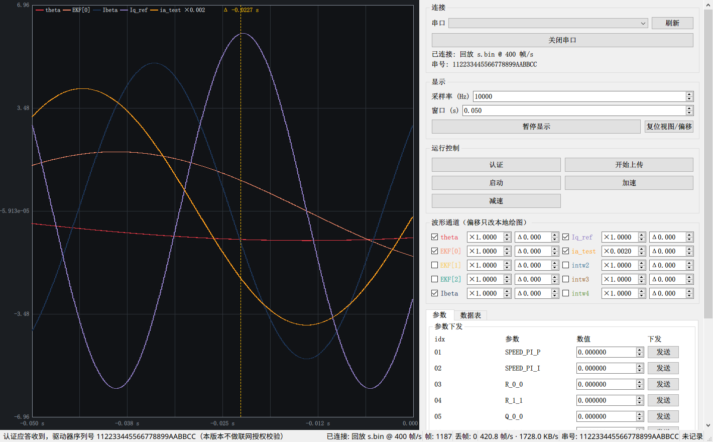

# SMotorDrive 上位机（Qt 版）

调试/标定上位机，替代原厂上位机（下称「原工程」），按与其驱动器固件配套的串口协议实现。
本项目**不包含**原工程的联网授权与 MySQL 依赖。

- 目标平台：Windows 10/11 x64（Qt 5.15.2 + MSVC2019 14.29 + VS 自带 CMake/Ninja）
- 设备侧：STM32 USB CDC 虚拟串口（Win10+ 用系统 `usbser.sys`），8N1
- 绘图：**自绘 `QPainter` 实时波形**（无第三方绘图库 → 无 GPL 授权牵绊，见计划书 §3.2）

> 命名约定：统一用「原工程」指代原厂上位机及其厂商名，文档与代码中不出现原始品牌字样。
> 协议依据与逆向资料为本地私有文档，未随本仓库发布；协议速查见下方 §4。


---

## 1. 构建 / 测试 / 打包（均已在本机实测通过）

```bat
build.bat            :: 配置 + 编译           -> build\smdrive-host.exe
build.bat test       :: 编译 + 单元测试       -> 100% tests passed
build.bat deploy     :: 编译 + windeployqt    -> dist\（含 Qt DLL / 平台插件 / 许可文本）
packaging\make_installer.bat   :: 出安装包    -> installer\smdrive-host-1.0.0-setup.exe
```

运行（开发态）：把 `G:\Qt\5.15.2\msvc2019_64\bin` 加入 PATH 后启动 `build\smdrive-host.exe`；
或用 `build.bat deploy` 产出的 `dist\` 目录（自足，无需 PATH）。

## 2. 命令行参数

| 参数 | 说明 |
|---|---|
| `--replay <file.bin>` | 启动即进入回放模式（喂留档的原始字节流，不需要硬件） |
| `--fps <n>` | 回放速率（帧/s，默认 250） |
| `--rec-raw <file>` | 启动即记录原始流（可再次回放） |
| `--rec-csv <file>` | 启动即记录 CSV 宽表（每行一帧） |
| `--sample-rate <hz>` | 采样率（决定时间轴，默认 10000） |
| `--window <sec>` | 波形显示窗口，默认 0.2 |
| `--shot <file.png>` | 启动后抓一张界面截图（开发/验证用） |
| `--shot-delay <ms>` | 截图前等待毫秒数，默认 1500 |
| `--ch-gain "<ch>=<gain>[,…]"` | 启动时预设通道显示增益，如 `"6=0.002,7=0.001"` |
| `--auto-close <ms>` | N 毫秒后自动退出（自动化验证用） |

无头运行（CI/脚本）：`set QT_QPA_PLATFORM=offscreen`（`dist\platforms\` 已随包带 `qoffscreen.dll`）。
注意 offscreen 平台没有系统字体，截图里文字会是空白框；要看真实界面请用默认 windows 平台。

## 3. 界面布局（示波器式）

左侧是波形主显示区，右侧是一列调控面板，底部状态栏当读数条用：

```
┌──────────────────────────────────────┬─────────────────┐
│                                      │ 连接             │  串口 / 刷新 / 打开关闭
│          波形窗口（双轴网格 + 图例）    │ 显示             │  采样率 / 窗口 / 暂停 / 复位
│      滚轮缩放 · 拖动翻历史 · 双击复位   │ 运行控制         │  认证 / 开始上传 / 启动 / 加速 / 减速
│      虚线游标显示 Δt                  │ 波形通道 ×2 列   │  ☑显示 + ×增益 + Δ偏移（只改本地绘图）
│                                      │ 参数 | 数据表     │  参数下发 / 实时数值
│                                      │ 记录 / 回放       │  CSV+BIN 记录 / 回放 .bin
└──────────────────────────────────────┴─────────────────┘
   帧数 · 丢帧 · 帧率/带宽 · 串号 · 记录状态（状态栏读数条）
```



- 通道勾选框用通道自身颜色显示。`×` 是**显示增益**（示波器 V/div 的等价物），`Δ` 是绘图偏移；
  两者都只影响本地显示、不向驱动器发帧，"复位视图/偏移" 会把增益与偏移一起还原。
- 典型用法：整型通道是 ±2000 计数、浮点通道只有 ±几，给整型通道填 `×0.002` 就能让两者同屏可比
  （增益非 1 的通道会在图例里标出 `×值`）。
- 波形区交互：滚轮缩放窗口、左键拖动翻看历史（自动进入暂停态）、双击回到实时跟随。
- 右栏可拖动分隔条调宽窄，内容超高时自动出现滚动条。

## 3. 目录结构

```
smdrive-host/
├─ build.bat                 一键构建（含 test / deploy）
├─ CMakeLists.txt
├─ src/
│  ├─ protocol/              frame.h / frame_builder / frame_decoder（流式重同步状态机）
│  ├─ transport/             itransport.h / serial_transport / replay_transport
│  ├─ data/                  ring_buffer.h / datahub / recorder（CSV + 原始流）
│  ├─ app/                   channel_table.h（通道与参数唯一维护点）/ app_config
│  └─ ui/                    main_window / waveform_view（自绘）/ table_panel / param_panel
├─ tests/test_protocol.cpp   golden 用例 + 健壮性 + 数据层符号（13 项）
├─ tools/                    frame_injector.py（造流压测）/ params_example.json
├─ packaging/                app.iss（Inno Setup）/ make_installer.bat
└─ docs/                     界面截图（README 引用）
```

线程模型（计划书 §4.2）：串口/回放对象 `moveToThread` 到工作线程，解码在工作线程完成，
GUI 线程只接收已解析帧并写入环形缓冲；UI 由 **60 Hz 定时器**统一刷新（表格/波形/状态栏），
接收与渲染彻底解耦。

## 4. 协议摘要（上位机侧实现）

下行（`55 55 CMD [payload] AA AA`，无长度字段、无 CRC）：

| 帧 | 含义 |
|---|---|
| `55 55 01 AA AA` | 认证 |
| `55 55 03 27 10 AA AA` | 开始上传（16 位大端参数，原版固定 10000） |
| `55 55 06 <idx> <f32BE> AA AA` | 参数下发，idx = 01..0A ↔ 固件 `float_data_download` 0..9 |
| `55 55 07 / 08 / 09 / 0A AA AA` | 启动 / 加速 / 减速 / 停止 |

上行：`55 55 02 + 12B 序列号 + AA AA`（17 字节）；
`55 55 04 + 1710B payload + AA AA`（1715 字节）= 6 路浮点波形 + 4 路整型波形（各 40 点）+ 10 浮点 + 10 整型标量。
索引与物理量对照见 `src/app/channel_table.h` 与逆向报告附录 B/C。

## 5. 相对原版「原工程」的修复（对应报告 §7）

1. 参数帧恒定 4 字节大端 —— 输入 `0` 不再发出半字节错位帧（原版会写坏参数）。
2. 整型量按 `uint32` 解析、显示按 `int32` —— 负值不再触发崩溃退出（原版 `parseInt` 溢出即 `System.exit(0)`）。
3. 流式重同步状态机 + 长度表 + 帧尾校验 —— 任意切分/粘包/噪声均可恢复，并统计丢帧。
4. 无联网授权：认证应答仅显示序列号，不查 MySQL、不发 4 分钟心跳。
5. 新增：离线回放（倍速）、CSV+原始流留档、参数方案 JSON、显示暂停/缩放/游标、丢帧与速率读数。

## 6. 与计划书的偏差（已确认的选择）

| 计划书 | 实现 | 原因 |
|---|---|---|
| QCustomPlot / Qwt | **自绘 QPainter 波形** | 规避 GPL 授权牵绊（§3.2「自绘最干净」），并提供 min/max 抽点、排队重绘、偏移/缩放/游标 |
| Qt 6.5 可选升级 | 保持 **Qt 5.15.2** | 与现有 kit 完全匹配；`QSerialPort`/`QTest` 用法与 Qt6 一致 |
| `CMakePresets.json` | `build.bat` + `-S/-B` | VS 自带 CMake 3.20 对 presets 支持有限（§6 坑 10） |
| 纯 GUI（WIN32） | 保留**控制台**子系统 | 便于看日志与脚本化验证；退出时打印一行 ASCII 统计 |

## 7. 本次实测结果

| 项目 | 结果 |
|---|---|
| 编译 | 0 error（MSVC 14.29，C++20，`/W4 /permissive-`） |
| 单元测试 | **1/1 通过，13 项**：9 条 golden 帧逐字节匹配、0 值 4 字节、逐字节切分、分包+半帧、噪声+坏尾、payload 内伪造 `55 55 04`、认证帧、未知命令、环形缓冲回绕 |
| 回放 1000 帧（干净流） | `dataFrames=1000 authFrames=1 droppedFrames=0`，CSV 1001 行（表头+1000），raw 回写与输入**哈希一致** |
| 回放 1000 帧（5 帧破损 + 每帧 3 字节噪声） | `dataFrames=995 droppedFrames=5`，raw = 1706442 字节 = 995×1715+17（与预期完全一致） |
| 部署自足性 | `dist\` 脱离 Qt 目录、仅系统 PATH 下启动成功并完成 1000 帧回放 |
| 安装包 | `installer\smdrive-host-1.0.0-setup.exe`（Inno Setup 6.2.0，31.4 MB） |

## 8. 待真机联调（需要板子在场才能确认）

1. **DTR/RTS 时序**：打开端口时已显式拉低；若你的板子对 DTR 变化敏感，可能需要在 UI 增加「打开后延迟发送认证」的手动开关。
2. **`03` 命令的 16 位参数语义**：目前按原版固定发 `0x2710`，界面留了可配置入口；`10000/参数` 的取帧逻辑需实测帧率反推。
3. **采样率标定**：时间轴依赖 `--sample-rate`（默认 10 kHz），实测后写进 `AppConfig` 默认值。
4. **协议加固（可选，计划书 §8）**：若固件加 `LEN + SEQ + CRC16`，上位机按双模式解码扩展（约 0.5 天）。
